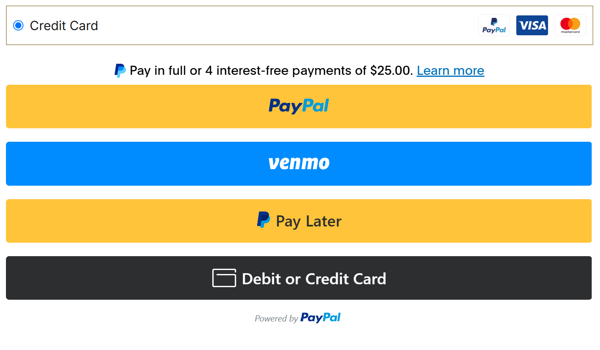
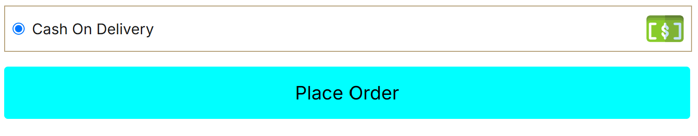

---

# LUXURIA – Simple E-commerce Website

I’m a self-taught developer currently building my skills in HTML, CSS, JavaScript, React, responsive design, APIs, and backend integration through hands-on projects.

This project includes features such as dynamic products, a shopping cart, checkout, PayPal payments, and Cash on Delivery. Also, an auto-mail reply after successful order.

I built this project to get more familiarized with integrating the Paypal SDK, enhance more what I've learned so far, and continue improving and brushing up my skills.

⚠️ \*\*Payment Testing:

Please do not use an actual Paypal account or debit/credit card when testing the website payment.

I provided test accounts for these, so please use those instead when testing.

_See the "How to Use" explanation below._

Images are AI generated and edited it with GIMP to fit my design

Some Icons, especially SVG icons, were sourced from https://www.svgrepo.com/

Below is the live preview

[View Live Website](https://your-website-url.com)

## How to Use

1. Go to Shop page
2. Add item to cart (Hover to an item to show cart button)
3. In popup modal add quantity and/or select color then click Add to cart
4. On the top right click cart/bag icon (Between the heart and person icons)
5. Click Proceed to Checkout
6. Fill the form

\*Use your actual email also if you want to test the auto-reply for the placed orders.

Note: If you dont feel like it to use your actual email.

Go ahead and just input something else.

I did not put email validator on this form so its ok to input anything.

But, it will still going to check if the email is in its correct format to enable the selection of payment method.

7. Select payment method

\*If paypal is selected

### Test Payment

This website uses PayPal Sandbox, so no real money is charged.

#### PayPal / Pay Later

Use the following PayPal Sandbox Buyer Account:

email: user-demo@personal.example.com

password: userdemo2026

#### Debit / Credit Card

For the Debit or Credit Card payment option, use the Sandbox test card:

Card number: 5110926875133391

Expiry date: 11/2031

CVC code: 295

Contact/Phone: 2028733840

As for state and zip code use this website
\*Input actual state and its city to make the payment succesful.
You can input anything in the street input box.

https://apps.naaccr.org/vpr-cls/about-postal-codes

⚠️ These are Sandbox test credentials and are not real payment information. Use them only on the PayPal Sandbox checkout.

\*If Cash-On-Delivery is selected just fill the form then click place order button

\*Loading and rendering of data may take some few second up to 60 seconds dependig to the Google apps script and/or Render backend booting up.
